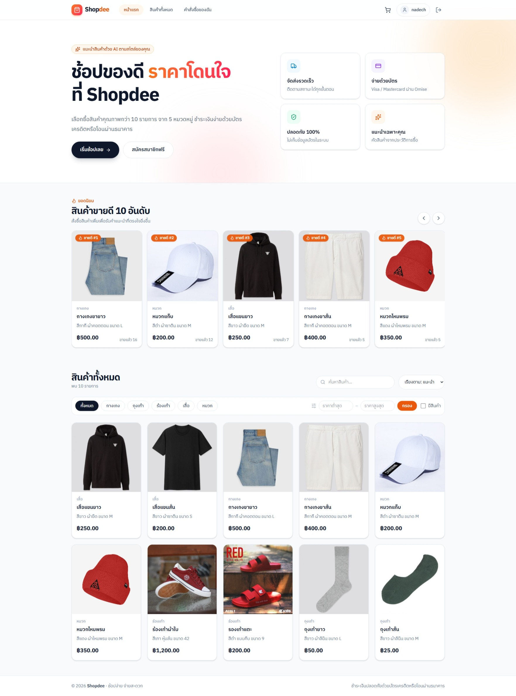
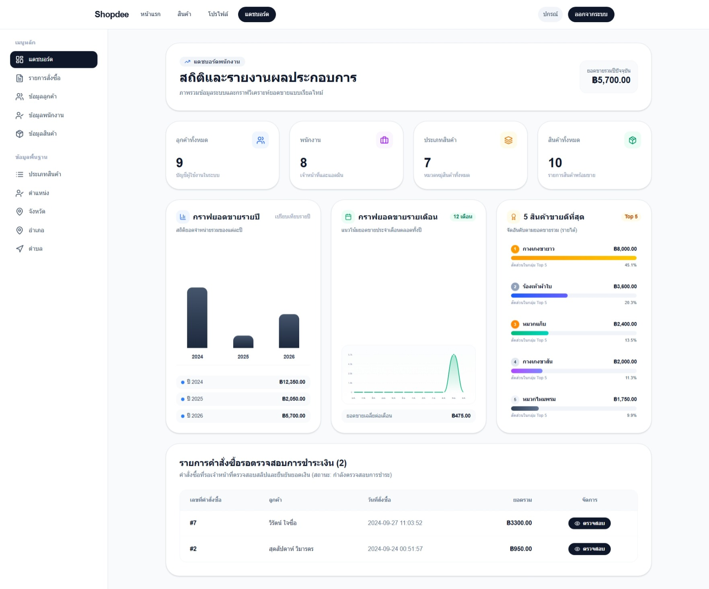
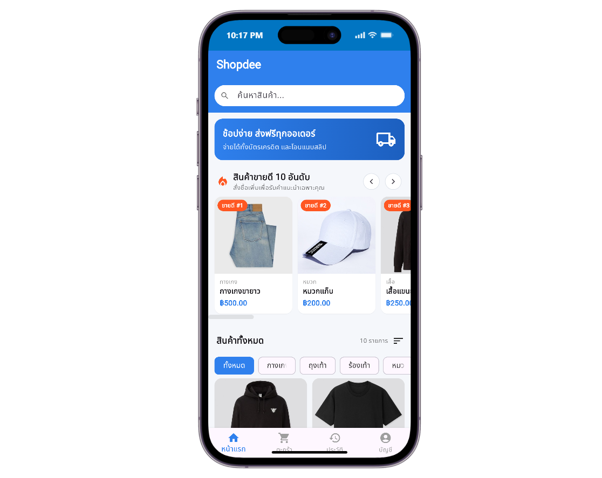
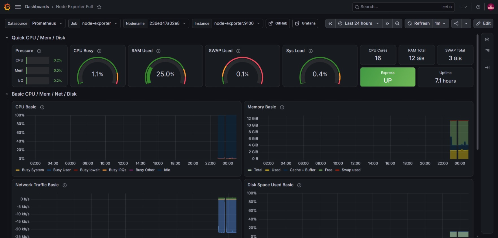

# Shopdee

Shopdee is an online clothing store with a Next.js website, a Flutter app (Android and web), an Express REST API, a Flask product-recommendation service and a MySQL database. Customers browse products, add them to a cart, and pay by credit card (Omise) or by bank transfer with a payment slip. Staff manage orders, products and master data from an admin dashboard. The whole system runs with Docker Compose behind nginx, and includes Prometheus/Grafana monitoring with e-mail and LINE alerts, plus API, end-to-end, performance and usability tests.

## Screens

### Website: Home

The home page shows 10 recommended products: personal picks from the recommendation model for customers with a purchase history, topped up with best sellers. Below them is the full catalogue with search, category, price and stock filters.



### Website: Admin Dashboard

Staff see sales statistics, yearly and monthly sales charts, the top 5 products and the orders whose payment slips are waiting to be checked. The side menu manages orders, customers, employees, products and master data.



### Mobile App: Home

The Flutter app has the same recommendations, search, category chips and sorting, with tabs for the cart, order history and account.



### Monitoring: Grafana

Grafana shows host metrics from Node Exporter and the availability of every service (for example the green **Express UP** panel) from the Blackbox Exporter.



## Features

**Customers (website and app)**

- Register, log in, edit the profile and upload a profile picture
- Browse and search products; filter by category, price range and stock; sort by price or newest
- Product recommendations: up to 10 personal picks from the ML service, filled up to 10 with the best sellers (guests see the 10 best sellers)
- Cart: add products, change quantities, remove items, confirm the order
- Pay by credit card through Omise (card details go straight to Omise; the shop never receives the card number)
- Pay by bank transfer and upload a payment slip
- Order history with a status timeline (waiting for payment → checking payment → paid → shipping → delivered)

**Staff (admin dashboard on the website)**

- Dashboard: customer, employee, product-type and product counts, sales by year and month, top 5 products
- Orders: list all orders, change an order's status, view the latest payment slip and approve or reject it
- Manage customers, employees, products (with images), product types, positions, provinces, districts and sub-districts

**Operations**

- One Docker Compose project for all services, published through nginx on port 80
- Monitoring with Prometheus, Node Exporter, Blackbox Exporter and Grafana
- Alerts by Gmail and LINE when the Express API goes down and when it comes back up
- Automated tests: Jest (API), Playwright (web), Flutter widget tests, Lighthouse, JMeter and a SUS questionnaire

## Tech Stack

| Component | Technology | Purpose |
|---|---|---|
| Website | Next.js 15 (App Router), React 19, TypeScript, Tailwind CSS 4 | Customer storefront and admin dashboard |
| Mobile app | Flutter, Dart (`http`, `shared_preferences`, `flutter_dotenv`, `omise_flutter`, `image_picker`, `fl_chart`) | Android app; also built as a web app |
| REST API | Node.js 24, Express 5, TypeScript, `mysql2`, JWT, bcrypt, `express-validator`, `express-fileupload` | Accounts, products, cart, orders, payments, reports |
| Recommendation | Python 3.12, Flask, scikit-learn (KNN), pandas, Gunicorn | Product recommendations from purchase history |
| Database | MySQL 9.7 | Store data; the schema and sample data load on first start |
| Payment | Omise (Omise.js on the web, `omise_flutter` on Android, Charges API on the server) | Credit-card payments |
| Reverse proxy | nginx | One entry point on port 80 for the website, APIs and Grafana |
| Monitoring | Prometheus, Node Exporter, Blackbox Exporter, Grafana | Metrics, service health checks, dashboards, alerting |
| Alert relay | Python, Flask, Gunicorn (`line-notifier`) | Forward Grafana alerts to the LINE Messaging API |
| Testing | Jest + Supertest, Playwright, Flutter test, Lighthouse, Apache JMeter, openpyxl | API, functional, end-to-end, performance and usability tests |
| Containerization | Docker, Docker Compose | Build and run every service |

## Architecture

```text
                              ┌──────────────────────── Docker network: shopdee_network ────────────────────────┐
 Browser ──── :80 ───► nginx ─┼─ /            ──► nextjs:3000  (website; server side calls express:4000, flask:5000)
                              ├─ /api/node/   ──► express:4000/api/ ──► mysql:3306
                              ├─ /api/flask/  ──► flask:5000/api/   ──► mysql:3306
                              └─ /grafana/    ──► grafana:3000 ──► prometheus:9090 ──► node-exporter, blackbox-exporter
 Browser ── :8080 ──► flutter (Flutter web, nginx)                          Grafana alerts ──► Gmail (SMTP)
 Android phone ── http://<PC LAN IP>/api/node, /api/flask                   Grafana alerts ──► line-notifier ──► LINE
                              └──────────────────────────────────────────────────────────────────────────────────┘
```

Only nginx (port `80`) and the Flutter web app (port `8080`) are published on the host; every other service is reachable only inside the Docker network.

## Project Structure

```text
shopdee-app/
├── docker-compose.yml              # Root project: includes the three compose files below
├── .env.example                    # DOCKER_USER (image name prefix), GRAFANA_ROOT_URL
├── backend/
│   ├── docker-compose.yml          # mysql, express, flask
│   ├── mysql/
│   │   ├── Dockerfile              # MySQL image that loads schema.sql on first start
│   │   ├── schema.sql              # Tables and sample data
│   │   └── .env.example            # DB_NAME, DB_PASSWORD
│   ├── express/
│   │   ├── src/index.ts            # REST API (all routes)
│   │   ├── tests/api.test.ts       # Jest + Supertest API tests (database mocked)
│   │   ├── assets/                 # Uploaded images: customer/, employee/, product/, payment/
│   │   ├── swagger.js              # Generates src/swagger-output.json
│   │   ├── Dockerfile
│   │   └── .env.example
│   └── flask/
│       ├── api.py                  # Recommendation API (KNN)
│       ├── requirements.txt
│       ├── Dockerfile
│       └── .env.example
├── frontend/
│   ├── docker-compose.yml          # nextjs, flutter, nginx
│   ├── nginx/default.conf          # Reverse proxy routes
│   ├── nextjs/
│   │   ├── src/app/                # Pages: home, products, cart, orders, login, register, profile, admin
│   │   │   └── api/recommendations # Server route: ML picks + best sellers
│   │   ├── src/components/         # Shop UI (components/shop) and admin tabs
│   │   ├── src/lib/                # API client, Omise.js helper, session helpers, types
│   │   ├── tests/                  # Playwright specs, helpers, Lighthouse runner and reports
│   │   ├── playwright.config.ts
│   │   ├── Dockerfile
│   │   └── .env.example
│   └── flutter/
│       ├── lib/main.dart           # App entry and bottom navigation
│       ├── lib/src/                # Screens: home, product detail, cart, payment, slip upload, history, account
│       ├── test/                   # Flutter widget and unit tests
│       ├── pubspec.yaml
│       ├── Dockerfile              # Builds the Flutter web app and serves it with nginx
│       └── .env.example
├── monitor/
│   ├── docker-compose.yml          # prometheus, node-exporter, blackbox-exporter, grafana, line-notifier
│   ├── prometheus/prometheus.yml   # Scrape targets and blackbox probes
│   ├── blackbox/blackbox.yml       # HTTP probe module
│   ├── grafana/provisioning/       # Data source, alert rules, contact points, notification policy
│   ├── line-notifier/              # Flask relay: Grafana webhook → LINE Messaging API
│   └── .env.example                # Gmail SMTP and LINE settings
├── tests/
│   ├── jmeter_script/              # JMeter plan, runner and results converter
│   ├── template/                   # Test-case templates (Excel)
│   └── test-results/               # Test reports (Excel/HTML) and the SUS workbook generator
├── docs/screenshots/               # Images used in this README
└── README.md
```

## Requirements

- Docker Desktop with Docker Compose v2.20 or later (for `include`)
- An Omise account for card payments (test keys are enough for development)
- For development outside Docker: Node.js 24, Python 3.12, Flutter SDK (Dart 3.7+), and a MySQL server
- For the Android app: Android SDK, and a phone on the same Wi-Fi network as the computer running Docker
- For testing: Google Chrome (Playwright and Lighthouse), Apache JMeter 5.6 with Java, and Python with `openpyxl`
- Optional: a Gmail account with an App Password and a LINE Messaging API channel for alerts

## Setup and Run

### 1. Create the environment files

Copy each example file and fill in the values. All `.env` files are ignored by git.

```powershell
Copy-Item .env.example .env
Copy-Item backend\mysql\.env.example backend\mysql\.env
Copy-Item backend\express\.env.example backend\express\.env
Copy-Item backend\flask\.env.example backend\flask\.env
Copy-Item frontend\nextjs\.env.example frontend\nextjs\.env
Copy-Item frontend\flutter\.env.example frontend\flutter\.env
Copy-Item monitor\.env.example monitor\.env
```

Values for running in Docker:

| File | Variable | Docker value | Notes |
|---|---|---|---|
| `backend/mysql/.env` | `DB_NAME`, `DB_PASSWORD` | `shopdee`, your password | Become the MySQL database and root password |
| `backend/express/.env` | `DB_HOST` | `mysql` | Container name, not `localhost` |
| | `DB_NAME`, `DB_USER`, `DB_PASSWORD`, `DB_PORT` | `shopdee`, `root`, same password, `3306` | Must match `backend/mysql/.env` |
| | `HOST_PORT` | `4000` | |
| | `SECRET_KEY` | a long random string | Signs the JWT tokens |
| | `omise_secret_key` | `skey_test_...` | Omise **secret** key; server only |
| `backend/flask/.env` | `DB_HOST`, `DB_NAME`, `DB_USER`, `DB_PASSWORD` | `mysql`, same as above | |
| `frontend/nextjs/.env` | `NEXT_PUBLIC_API_BASE_URL` | `http://localhost/api/node` | Used by the browser, so it goes through nginx |
| | `API_BASE_URL` | `http://express:4000/api` | Used by the Next.js server inside Docker |
| | `ML_BASE_URL` | `http://flask:5000/api` | Used by the Next.js server inside Docker |
| | `NEXT_PUBLIC_OMISE_PUBLIC_KEY` | `pkey_test_...` | Omise **public** key |
| `frontend/flutter/.env` | `API_URL` | `http://localhost/api/node` | For an Android phone use the PC's LAN IP (see step 4) |
| | `ML_URL` | `http://localhost/api/flask` | |
| | `omise_public_key` | `pkey_test_...` | Omise **public** key |
| `monitor/.env` | `GF_SMTP_*`, `ALERT_EMAIL_TO`, `LINE_*` | see [Monitoring and Alerting](#monitoring-and-alerting) | Optional |

`NEXT_PUBLIC_*` values and the Flutter `.env` are built into the website and the app. Rebuild the container after changing them.

### 2. Start all services

Run from the project root. The root `docker-compose.yml` includes the backend, frontend and monitor compose files as one project on the `shopdee_network` network.

```powershell
docker compose up -d --build
docker compose ps
```

On the first start, MySQL creates the database from `backend/mysql/schema.sql` (tables and sample products). This happens only while the `mysql_data` volume is empty.

| URL | Service |
|---|---|
| http://localhost/ | Website (Next.js) |
| http://localhost/admin | Admin dashboard (log in as a staff member; default login `admin` / `12345678`) |
| http://localhost:8080/ | Flutter web app |
| http://localhost/api/node/health | Express API health check |
| http://localhost/api/flask/health | Flask API health check |
| http://localhost/grafana/ | Grafana (default login `admin` / `admin`; change it on first login) |

View logs, rebuild one service, or stop everything:

```powershell
docker compose logs -f express
docker compose up -d --build express
docker compose down          # keeps the database volume
docker compose down -v       # also deletes the database and Grafana data
```

Always run `docker compose` from the project root. Running it inside `backend/`, `frontend/` or `monitor/` creates a separate project that cannot see the running containers.

### 3. Website

Open http://localhost/. Register a customer account, or log in with the **พนักงาน** (staff) tab to reach the admin dashboard. After confirming the cart, the order page offers two payment methods:

- **บัตรเครดิต** (credit card): use an Omise test card such as `4242 4242 4242 4242`, any name, a future expiry date and any 3-digit CVV
- **โอน / แนบสลิป** (bank transfer): upload an image of the slip; staff approve or reject it from the order detail in the admin dashboard

### 4. Android Application

The phone must reach the computer running Docker, so `localhost` does not work. Find the computer's IPv4 address with `ipconfig` and set it in `frontend/flutter/.env`, without a trailing slash:

```env
API_URL=http://192.168.1.101/api/node
ML_URL=http://192.168.1.101/api/flask
omise_public_key=pkey_test_...
```

Both devices must be on the same network, and Windows Firewall must allow inbound connections to port `80`. Then run:

```powershell
cd frontend\flutter
flutter pub get
flutter devices
flutter run
```

Restart the app after changing `.env`; hot reload does not reload it. For plain HTTP during development, Android may need `android:usesCleartextTraffic="true"` on `<application>` in `android/app/src/main/AndroidManifest.xml`; use HTTPS in production.

On Android, card payment uses the `omise_flutter` card form. On Flutter web (http://localhost:8080) the app shows its own card form, because the native Omise plugin does not run in a browser.

### 5. Development without Docker (optional)

Start MySQL locally and import `backend/mysql/schema.sql`, then set `DB_HOST=localhost` in the Express and Flask `.env` files and use the local-development values in the Next.js and Flutter `.env` files (`http://localhost:4000/api` and `http://localhost:5000/api`).

```powershell
cd backend\express;  npm install; npm run dev      # http://localhost:4000, Swagger UI at /api-docs
cd backend\flask;    pip install -r requirements.txt; python api.py   # http://localhost:5000
cd frontend\nextjs;  npm install; npm run dev      # http://localhost:3000
cd frontend\flutter; flutter pub get; flutter run -d chrome
```

Swagger UI (`/api-docs`) is available only when `NODE_ENV` is not `production`, so it is not served by the Docker image.

## How Recommendations Work

1. The Flask service (`GET /api/recommend/<custID>`) builds a customer-product purchase matrix from MySQL and uses a K-nearest-neighbours model (scikit-learn) to find products bought by similar customers.
2. The website calls its own route `GET /api/recommendations?custID=` on the Next.js server, which requests the ML picks from Flask and the best sellers from Express (`GET /api/product/popular`). The Flutter app does the same merge in the app.
3. The result shows up to 10 ML picks first, without duplicates, then fills the list up to 10 with the best-selling products (most ordered first). Guests and customers without history see the 10 best sellers.

## How Payments Work

- **Credit card:** the browser (Omise.js) or the Android app (`omise_flutter`) sends the card details directly to Omise and receives a one-time token. The app sends only that token to `POST /api/confirmpayment`. The API charges the card with the Omise secret key; it calculates the amount from the order in the database and accepts only the customer's own orders that are waiting for payment. On success the order becomes **paid** (status 3).
- **Bank transfer:** `POST /api/payment` stores the slip image in `backend/express/assets/payment/` and sets the order to **checking payment** (status 2). Staff approve it (status 3) or reject it (back to status 1) from the admin order detail, which always shows the latest slip of the order.

Order statuses: `0` cart, `1` waiting for payment, `2` checking payment, `3` paid, `4` shipping, `5` delivered.

## API Reference

Through nginx the Express API is at `http://localhost/api/node/...` and the Flask API at `http://localhost/api/flask/...`. Inside Docker they are `http://express:4000/api/...` and `http://flask:5000/api/...`.

Endpoints marked 🔒 need `Authorization: Bearer <token>` from `POST /api/login` (customer) or `POST /api/admin/login` (staff). Customers can only access their own data; 👔 endpoints need a staff token.

### Express: accounts and profile

| Method | Endpoint | Description |
|---|---|---|
| `GET` | `/api/health` | Health check: `200` when the API and MySQL respond, `503` when the database is down |
| `POST` | `/api/register` | Register a customer (`username`, `password`, `firstName`, `lastName`) |
| `POST` | `/api/login` | Customer login; returns `token` and `custID` |
| `POST` | `/api/admin/login` | Staff login; returns `token`, `empID` and `positionID` |
| `GET` | `/api/profile/:id` 🔒 | Customer profile |
| `PUT` | `/api/customer/:id` 🔒 | Update a customer |
| `POST` | `/api/customer/image/upload/:id` 🔒 | Upload a profile picture (`multipart/form-data`) |
| `GET` | `/api/customer/image/:filename` | Profile picture |

### Express: products

| Method | Endpoint | Description |
|---|---|---|
| `GET` | `/api/product` | All products with their type |
| `GET` | `/api/product/popular?limit=10` | Best sellers, most ordered first (limit 1–50) |
| `GET` | `/api/product/:id` | One product |
| `GET` | `/api/product/image/:filename` | Product image |
| `POST` `PUT` `DELETE` | `/api/product`, `/api/product/:id` 👔 | Create (with image), update, delete products |
| `GET` `POST` `PUT` `DELETE` | `/api/producttype`, `/api/producttype/:id` | Product types (changes 👔) |

### Express: cart, orders and payments

| Method | Endpoint | Description |
|---|---|---|
| `POST` | `/api/makeorder` 🔒 | Add a product to the cart (`custID`, `productID`, `quantity`, `price`) |
| `GET` | `/api/cart/:custID` 🔒 | Cart summary (order ID, total, delivery details) |
| `GET` `PUT` `DELETE` | `/api/cart/product/:custID` 🔒 | Cart items: list, change quantity, remove |
| `POST` | `/api/confirmorder` 🔒 | Confirm the cart; the order waits for payment |
| `POST` | `/api/confirmpayment` 🔒 | Pay by card (`custID`, `orderID`, `paymentToken`); `402` when the charge fails |
| `POST` | `/api/payment` 🔒 | Upload a transfer slip (`custID`, `orderID`, `price`, `slipFile`) |
| `GET` | `/api/payment/image/:filename` | Slip image |
| `GET` | `/api/history/:custID?year=` 🔒 | Customer order history |
| `GET` | `/api/orderinfo/:custID/:orderID` 🔒 | Order header for the customer |
| `GET` | `/api/orderdetail/:custID/:orderID` 🔒 | Order items |

### Express: administration 👔

| Method | Endpoint | Description |
|---|---|---|
| `GET` | `/api/admin/overview` | Customer, employee, product-type and product counts |
| `GET` | `/api/admin/history` | All orders |
| `GET` | `/api/orderinfo/:orderID` | Order detail with items and the latest slip |
| `GET` `POST` | `/api/admin/order/status` | Order statuses / change an order's status (`orderID`, `statusID`) |
| `GET` | `/api/reports/sales/year`, `/api/reports/sales/month?year=` | Sales by year and by month |
| `GET` | `/api/reports/sales/year/:custID` | Yearly spending of one customer (used by the app) |
| `GET` | `/api/reports/products/top?limit=` | Top-selling products |
| `GET` `POST` `PUT` `DELETE` | `/api/customer`, `/api/employee` (+ `/:id`) | Manage customers and employees |
| `GET` `POST` `PUT` `DELETE` | `/api/position`, `/api/province` (+ `/:id`) | Positions and provinces |
| `GET` `POST` `PUT` `DELETE` | `/api/district/:provinceID`, `/api/subdistrict/:districtID` (+ `/:id`) | Districts and sub-districts |

### Flask: recommendations

| Method | Endpoint | Description |
|---|---|---|
| `GET` | `/api/health` | Health check |
| `GET` | `/api/recommend/<custID>` | Recommended products for a customer (JSON array) |

```powershell
curl.exe http://localhost/api/node/product/popular?limit=3
curl.exe http://localhost/api/flask/recommend/1
```

## Monitoring and Alerting

The `monitor/` stack starts with the rest of the system.

| Service | Role |
|---|---|
| `node-exporter` | Host CPU, memory, disk and network metrics |
| `blackbox-exporter` | HTTP probes of nginx, Next.js, Express (`/api/health`, which also checks MySQL), Flask (`/api/health`) and Flutter |
| `prometheus` | Scrapes every 5 seconds; configured in `monitor/prometheus/prometheus.yml` |
| `grafana` | Dashboards and alerting at http://localhost/grafana/ |
| `line-notifier` | Receives Grafana's webhook and sends the message with the LINE Messaging API |

### Grafana

- The **Prometheus** data source is created automatically (`monitor/grafana/provisioning/datasources/`).
- Import the community dashboard **Node Exporter Full** (ID `1860`) for host metrics, as shown in the screenshot above.
- Service availability: `probe_success{job="blackbox", service="express"}` returns `1` when the service is up and `0` when it is down. For a Stat panel use the **Last** calculation, thresholds red (base) / green at `1`, and value mappings `1 → UP`, `0 → DOWN`. Other labels: `nginx`, `nextjs`, `flask`, `flutter`.
- Response time: `probe_duration_seconds{job="blackbox", service="express"}`. Uptime: `avg_over_time(probe_success{job="blackbox", service="express"}[24h]) * 100`.
- To open Grafana from another machine, set `GRAFANA_ROOT_URL` in the root `.env` (for example `http://192.168.1.10/grafana/`).

### Alerts: Express down / up

Alerting is provisioned from `monitor/grafana/provisioning/alerting/`:

- **Rule** (`rules.yml`): *Express API down* fires when `probe_success` for Express stays below 1 for 30 seconds (checked every 10 seconds). No data also counts as down.
- **Contact point** (`contact-points.yml`): `shopdee-alerts` sends to Gmail and to LINE, for both **DOWN** and **UP** (resolved).
- **Policy** (`policies.yml`): all alerts go to `shopdee-alerts`; first notification after 10 seconds, reminder every 4 hours while still down.

Fill in `monitor/.env`:

1. **Gmail:** create an App Password (Google Account → Security → 2-Step Verification → App passwords) and set `GF_SMTP_USER`, `GF_SMTP_PASSWORD`, `GF_SMTP_FROM_ADDRESS` and `ALERT_EMAIL_TO` (separate several addresses with `;`).
2. **LINE:** create a Messaging API channel in the LINE Developers console. Set `LINE_CHANNEL_ACCESS_TOKEN` (long-lived channel access token) and `LINE_TO` (your user ID from the Basic settings tab, or a group ID the bot has joined; several user IDs can be comma-separated). Add the bot as a friend first. LINE Notify was discontinued in 2025, so the Messaging API is used.
3. Apply the values. Containers read `env_file` only when they are created, so `restart` is not enough:

```powershell
docker compose up -d --force-recreate grafana line-notifier
```

Test the alert by stopping the API for at least a minute:

```powershell
docker stop express        # about 1 minute later: 🔴 DOWN on Gmail and LINE
docker start express       # about 1 minute later: 🟢 UP
docker restart nginx       # nginx caches the old container IP
docker logs -f line-notifier
```

Provisioned alert resources cannot be edited in the Grafana UI. Edit the YAML files and run `docker compose restart grafana`. The provisioned notification policy replaces any policy tree created in the UI.

## Testing

| Suite | Tool | Location | What it covers |
|---|---|---|---|
| API unit/integration | Jest + Supertest | `backend/express/tests/` | 84 tests for every Express endpoint, with MySQL, file writes and Omise mocked |
| Functional (web) | Playwright | `frontend/nextjs/tests/func.spec.ts` | Customer features and every admin tab (create, read, update, delete, errors) |
| End-to-end (web) | Playwright | `frontend/nextjs/tests/e2e.spec.ts` | Register → login, search and filter, cart, card and slip payment, order tracking, admin status change, recommendations |
| Mobile | Flutter test | `frontend/flutter/test/` | Recommendation merge logic, home page, tabs when logged out |
| Web performance | Lighthouse | `frontend/nextjs/tests/run_lighthouse.js` | Performance, accessibility, SEO and best practices of public and logged-in pages |
| Load and performance | Apache JMeter | `tests/jmeter_script/` | Login, catalogue, spike, add to cart, order history and soak tests |
| Usability | SUS questionnaire | `tests/test-results/create_sus_template.py` | System Usability Scale workbook |

Test-case templates are in `tests/template/` and reports in `tests/test-results/`.

### API tests (Jest)

```powershell
cd backend\express
npm test
```

The database and Omise are mocked, so no running services are needed. `tests/setup-env.ts` sets fixed test secrets, so the real `.env` is never used.

### Web tests (Playwright)

By default the tests run against the Docker stack at `http://localhost`. The browser's API calls are mocked, so the tests never change the database or call Omise; pages rendered on the server read the real product catalogue.

```powershell
cd frontend\nextjs
npx playwright install chromium     # first time only
npx playwright test                 # all specs
npx playwright test tests/e2e.spec.ts --headed
npx playwright show-report          # HTML report in playwright-report/
```

| Variable | Default | Purpose |
|---|---|---|
| `PLAYWRIGHT_BASE_URL` | `http://localhost` | Site under test |
| `PLAYWRIGHT_START_SERVER` | not set | `1` starts `npm run dev` first (use with `PLAYWRIGHT_BASE_URL=http://localhost:3000`) |
| `PLAYWRIGHT_SLOWMO` | `0` | Milliseconds between actions, for demonstrations |

E2E-RET-001/002 (returns) are marked `fixme` because the store has no return feature yet.

### Flutter tests

```powershell
cd frontend\flutter
flutter test
```

### Lighthouse

```powershell
cd frontend\nextjs
node tests\run_lighthouse.js
```

Writes full reports to `tests/lighthouse-reports/<case>.json` and a summary to `tests/lighthouse_results.json` (pass mark 70). For the logged-in pages the script logs in once as `perf_tester` (created on first use) and checks that each audited page really loaded customer data; otherwise the case is reported as `Error`. Settings: `LH_BASE_URL`, `LH_API_URL`, `LH_USER`, `LH_PASSWORD`, `LH_THRESHOLD`, `LH_CHROME_PATH`.

### JMeter

```powershell
python tests\jmeter_script\run_load_test.py                  # quick profile, about 6 minutes
python tests\jmeter_script\run_load_test.py --profile full   # template load (several hours)
python tests\jmeter_script\generate_jmeter_results.py        # copy results into the Excel report
```

The runner executes `shopdee_load_test.jmx` in non-GUI mode, writes the JTL file and an HTML report to `tests/jmeter_script/out/`, and evaluates each case against its SLA in `jmeter_results.json`. Each test case is its own thread group, run one after another; users, ramp-up and duration can be overridden with `-J` properties (see the comment at the top of the `.jmx`). JMeter is found from `--jmeter`, `JMETER_BIN`, `PATH` or `C:\jmeter\bin`.

JM-CHK-002 (checkout stress) is disabled because every iteration creates a real order; enable it only on a disposable database. The add-to-cart test writes only to the `perf_tester` customer's cart.

### SUS questionnaire

```powershell
python tests\test-results\create_sus_template.py             # empty workbook for real answers
python tests\test-results\create_sus_template.py --sample    # with labelled demo answers
```

Enter each respondent's 10 answers (1–5). The score, grade and adjective rating are calculated only for complete rows.

## Notes

- **Secrets:** keep `omise_secret_key`, `SECRET_KEY`, the database password, the Gmail App Password and the LINE token only in the server-side `.env` files. The Next.js `NEXT_PUBLIC_*` values and the Flutter `.env` are bundled into the website and the app, so they may contain only public settings such as API URLs and the Omise **public** key.
- **nginx after rebuilding:** nginx caches the IP address of each container. After recreating `express`, `flask` or `nextjs`, run `docker restart nginx`, otherwise `/api/node` or the website returns `502`.
- **Uploaded files** are stored inside the `express` container (`assets/`). Recreating the container resets them to the files in the image; mount a volume on `/app/assets` to keep uploads.
- **Database schema** loads only on the first start. To start again from `schema.sql`, run `docker compose down -v` (this deletes all data).
- **Grafana** starts with `admin` / `admin`; change the password before exposing it.
- **CORS:** the APIs allow all origins for development. Restrict them before deploying to production.
- **Test accounts:** Lighthouse and JMeter create the customer `perf_tester` / `password1234`. Remove it from production data.
- **Known performance issue:** customer login uses `bcrypt.compareSync`, which blocks Node's event loop; login saturates at about 12 requests per second in the JMeter tests. Switching to the asynchronous `bcrypt.compare` is recommended.
